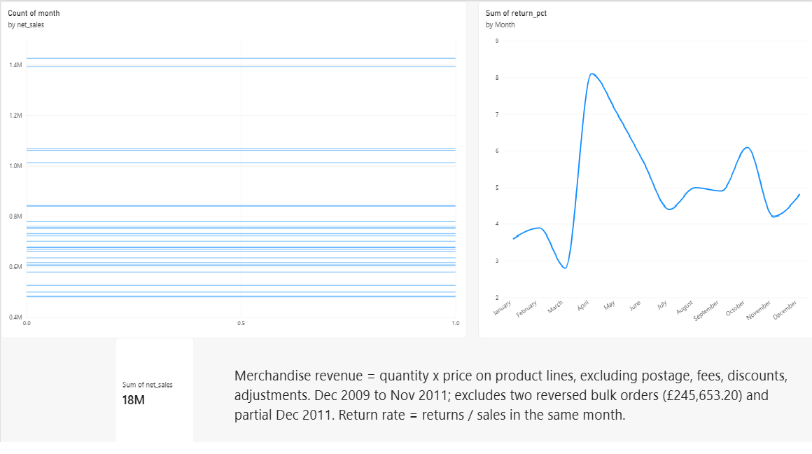
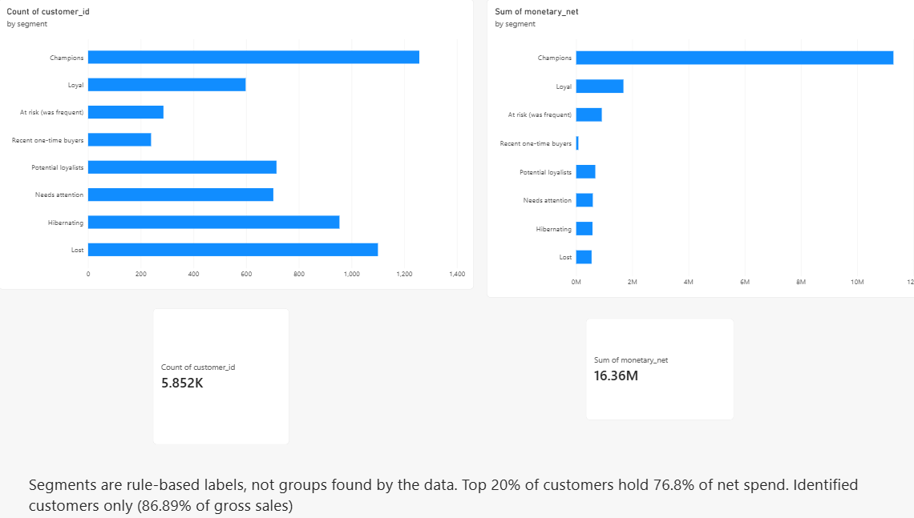
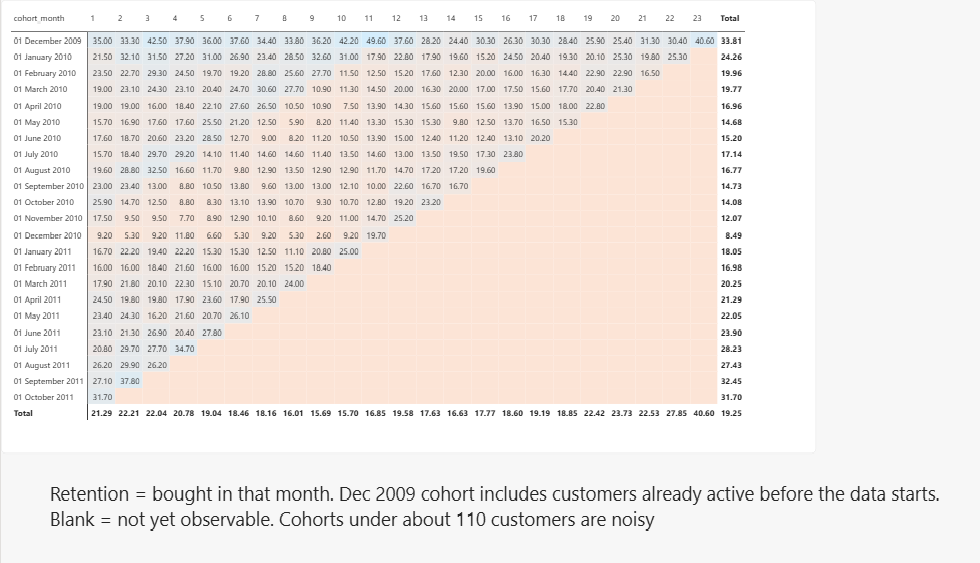

# Retail customer analytics (UCI Online Retail II)

Customer analytics for a UK online retailer, built as a two-month-intern-style task on a public dataset. It covers data cleaning with documented rules, RFM segmentation, cohort retention, returns, and Q4 seasonality.

**Data:** UCI Online Retail II, 1,067,371 transaction lines, 1 Dec 2009 to 9 Dec 2011 ([dataset page: https://archive.ics.uci.edu/dataset/502/online+retail+ii]). The data is not stored in this repo.

**Tools:** Python (pandas), DuckDB SQL, Jupyter, Power BI.

## Key findings

Merchandise revenue = quantity x price on product lines, excluding postage, fees, discounts, adjustments, vouchers and test items. Net = after returns.

| Question | Result |
|---|---|
| Cleaning | 1,067,371 raw lines -> 1,021,272 clean lines; all 46,099 removed lines are traced to a rule |
| Customer coverage | 86.89% of gross merchandise sales carry a customer ID; customer analysis covers 5,852 customers |
| Concentration | Top 20% of customers hold 76.8% of net spend; 27.7% bought only once |
| Retention | Of 3,288 customers first seen Jan to Nov 2010, 70.0% bought again within a year |
| Returns | 2.43% of gross merchandise sales (3.65% including two reversed bulk orders worth £245,653.20) |
| Q4 | Oct to Dec = 35.3% of 2010 net sales; like-for-like Q4 net sales +3.0% in 2011 on 2.8% fewer orders |

## Repo layout

- `notebooks/` run in order: 01 load, 02 profile, 03 clean (DuckDB SQL), 04 RFM, 05 cohorts, 06 returns and seasonality
- `dashboard/` Power BI file and page screenshots
- `cleaning_rules.md` every cleaning rule with its evidence and row counts

## Run it yourself

1. Download the dataset and save it as `data/online_retail_II.xlsx`.
2. `pip install -r requirements.txt`
3. Run notebooks 01 to 06 in order. Each saves its output into `data/` for the next.

## Dashboard

## Limitations

- Public dataset; costs and margins are unknown, so findings are about sales, not profit.
- Segment names are rule-based labels, not groups discovered by the data.
- Returns are not matched to original orders.
- Early 2010 cohorts may include established customers who skipped Dec 2009.
- Q4 2011 is incomplete (data ends 9 Dec 2011).